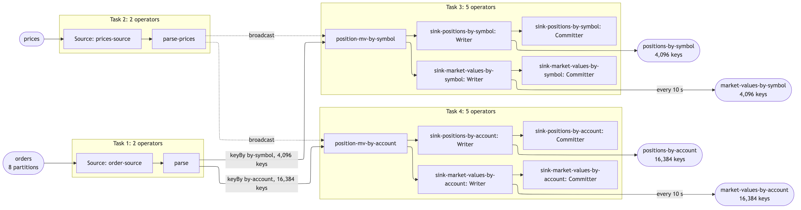

# st53 — positions and market values, proved to scale

A Flink DataStream pipeline built in clean-room run `st53` by an agent
following the `scalable-flink-skill` skill, with no human available. The
interview answers are the skill's defaults (`ANSWERS.md`); everything they
left open is in `ASSUMPTIONS.md`, and the plan written before any number
existed is `PLAN.md`.

## What it does

In the words of the interview's default (question 1, verbatim in `ANSWERS.md`):
an order arrives with a unique id and symbol, order quantity and a list of
allocations; each allocation is keyed by account / sub-account and carries a
quantity. The pipeline maintains positions by account + sub-account + symbol
and by symbol. A second input carries prices, keyed by symbol and timestamp;
the pipeline joins those to each of the position outputs and emits a market
value every 10 seconds for both. Positions are published as they change, one
per input; only the market value is throttled.

**Fan-out:** every order has 4 allocations (A1/S1, A1/S2, A2/S1, A2/S2), so
one order produces **5 position records**: 1 on `positions-by-symbol` and 4
on `positions-by-account`. The market values are per 10-second interval, not
per order, and are not counted in the 5.



The picture above is drawn by the harness from the running job's plan
(`results/graph.md` has the paragraph and the Mermaid source).

## Topics

| topic | role | key | value | partitions | written by | `pipeline.json` list |
|---|---|---|---|---|---|---|
| `orders` | input, scaled to capacity | none | JSON order | 8 | the generator (`GenerateBacklog`), through the harness's fill | `topics.in`, `design.inputs` |
| `prices` | second input, broadcast | symbol | JSON price | 8 | the generator, once (skipped when already full) | `design.inputs` |
| `positions-by-symbol` | output, one per order | symbol | JSON position | 8 | the job | `topics.out` |
| `positions-by-account` | output, four per order | `account\|sub\|symbol` | JSON position | 8 | the job | `topics.out` |
| `market-values-by-symbol` | output, every 10 s per changed key | symbol | JSON market value | 8 | the job | `topicsAlsoWritten` |
| `market-values-by-account` | output, every 10 s per changed key | `account\|sub\|symbol` | JSON market value | 8 | the job | `topicsAlsoWritten` |

The harness also creates `orders-tiny` and `orders-small` (its tiny-proof and
completeness copies of `orders`, written by the same generator) and recreates
the output topics before each case. Order ids increase within each partition,
and order *u* is written to partition *u* mod 8.

## Record formats

One real record off every topic, read by the harness after completeness, is in
[`results/records.md`](results/records.md). The fields are described in
`ASSUMPTIONS.md` (A1–A7); examples are not typed here.

## How the job is built

| operator (`design.operators`) | what it does |
|---|---|
| `order-source` | Kafka source on `orders`, consumer group from the harness, offsets committed on checkpoint. Hands over the raw bytes. |
| `parse` | Parses each order's JSON once. The order goes to the main output (for the symbol aggregation); its four allocations go to a side output (for the account aggregation). |
| `prices-source` | Kafka source on `prices`, from the earliest offset. |
| `parse-prices` | Parses each price; the stream is then broadcast to both aggregations. |
| `position-mv-by-symbol` | Keyed by symbol. Keeps the position and the count of orders applied, publishes the absolute position on every order, drops a repeated order by its id, keeps the newest price per symbol from the broadcast, and every 10 s publishes position × latest price for each key whose position or price changed. |
| `position-mv-by-account` | The same, keyed by account / sub-account / symbol, fed by the allocations; prices are looked up by the key's symbol. |
| `sink-positions-by-symbol` | Kafka sink to `positions-by-symbol`, at-least-once, lz4, keyed by symbol. |
| `sink-positions-by-account` | Kafka sink to `positions-by-account`, keyed by account / sub-account / symbol. |
| `sink-market-values-by-symbol` | Kafka sink to `market-values-by-symbol`. |
| `sink-market-values-by-account` | Kafka sink to `market-values-by-account`. |

Guarantee: exactly-once checkpointing every 10 s; the sinks are at-least-once
and made idempotent by always publishing the absolute value for a key.
Repeated input records (0.5% on purpose) are dropped by order id: each key
keeps the highest id it applied from each of the 8 input partitions.

## Correctness

The verifier (`VerifyCompleteness`) reads all four output topics to their end
and compares them with the generator's manifest, with no tolerance:

- distinct keys: 4,096 symbols and 16,384 account / sub-account / symbol keys, on every output;
- every key's last position and order count equal the manifest's, on both position topics;
- every key's last market value carries the newest price (by timestamp) and equals final position × that price, on both market-value topics;
- the two paths agree: for every symbol, the four account positions add up to the symbol position;
- every key sits in exactly one partition of every output;
- each key's order count never goes backwards on the **clean** run, and goes backwards at most once on the **killed** run (the replay after the restart);
- on the clean run there is exactly one symbol position per order and four account positions; the input repeated 0.5% of its records on purpose and each was counted once.

## How to build and run it

```
export DOCKER_CONFIG=$HOME/.docker-nohelper
export PATH=/opt/homebrew/opt/openjdk@17/bin:$PATH
(cd job && mvn -q package)
H=~/.claude/skills/scalable-flink-skill/harness/prove.py
python3 $H replay
nohup python3 $H all > results/all.log 2>&1 &     # up, preflight, completeness, tinyproof, fill, suite, report
```

Wait on `results/DONE`; `results/PROGRESS.txt` says where the chain is. Steps
can be re-run one at a time with `prove.py up | preflight | completeness |
tinyproof | fill | suite | report | down`. The dashboard is Grafana at
`http://localhost:13000` (Prometheus at `:19090`), provisioned from `dashboard/`.

## Results

- [`results/headline.md`](results/headline.md) — rates per case and the step ratios, written by `prove.py report`.
- [`results/graph.md`](results/graph.md) — the job graph read off the running plan.
- `FIXES.md` and `SKILL-FEEDBACK.md` — what was changed to chase a number, and what the skill got wrong.
