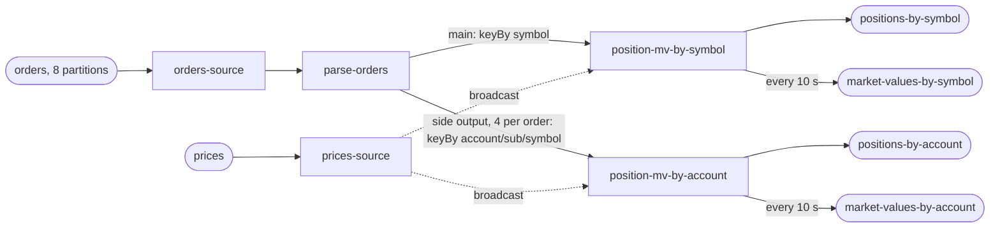

# Plan

Written 2026-10-12, before any code and before any number existed.
**No one approved this plan.** Clean-room run 54 has no human to ask, so it
builds against this plan as written (SKILL §1a). The six answers are in
`ANSWERS.md`; everything they did not settle is in `ASSUMPTIONS.md`.

## The test

| | |
|---|---|
| the objective | near-linear scaling across 1, 2 and 4 cores. Each step must return **1.80× or better** on a doubling, judged on the low end of the step's range with a 1% margin. Two steps are reported, 1→2 and 2→4 |
| where it runs | this laptop (Apple Silicon, 8 cores, 16 GB; Docker VM about 12,955 MiB), in Docker |
| the stack | `flink:1.20.1-scala_2.12-java17`, `apache/kafka:3.9.0`, plus Prometheus, Grafana and the skill's container CPU exporter for the dashboard |
| what is measured | the drain rate of a fixed backlog of orders at each core count, read from committed broker offsets, with the resource columns beside it. Second reading: output rows on the two position topics divided by 5 |
| what is proved first | completeness with no tolerances, re-checked after killing the pipeline mid-run. No throughput table is published for a build that has not passed |
| what is built | the pipeline (Flink DataStream job), a deterministic generator, a verifier, the dashboard, a README |
| the shape of the suite | 3 passes per case, ascending then descending then ascending, then the 1-core baseline once more: **10 measured cases**. Up to 6 more if a step's range reaches both sides of the target |
| the guarantee | exactly-once checkpointing every **10 s**; an at-least-once Kafka sink made idempotent by emitting the absolute position per key |
| how long it takes | **about 2½ hours**, unattended: up and preflight 10 min, completeness 10 min, tiny proof 30 min, fill 15 min, suite 70 min, report 5 min. A wrong backlog guess adds a tiny proof |
| what it writes | suite backlog 250,000,000 orders; tiny proof 150,000,000; completeness 6,000,000. Estimated 15–25 GB of Kafka log with lz4, more if compression does less than expected. Host had 116 GB free when this was written. The tiny proof replaces this estimate with measured bytes per record |
| what it occupies | ports 19092 (Kafka), 18081 (Flink REST), 13000 (Grafana), 19090 (Prometheus). 8 partitions. Containers, volumes and the network are all prefixed `st54` |
| where to watch it | `results/PROGRESS.txt` — one sentence, overwritten: which step of seven, which case of ten, roughly how long is left. **This run is a detached agent with no channel to a person until it finishes.** Whoever started it can read that file at any time; I will not promise updates I cannot deliver |

## The pipeline

| harness list | topics |
|---|---|
| `topics.in` | `orders` |
| `topics.out` | `positions-by-symbol`, `positions-by-account` (fan-out 1 + 4 = **5**) |
| `topicsAlsoWritten` | `market-values-by-symbol`, `market-values-by-account` |
| `design.inputs` | `orders`, `prices` |

Operators, as `design.operators`: `parse-orders`, `position-mv-by-symbol`,
`position-mv-by-account`, `sink-positions-by-symbol`, `sink-positions-by-account`,
`sink-market-values-by-symbol`, `sink-market-values-by-account`.

## Correctness the verifier asserts (SKILL §4)

On both arms: every symbol and account position equals the manifest's total;
each position's input count equals the manifest's; 4,096 and 16,384 distinct
keys on every output; the two paths' grand totals agree with each other and the
manifest; every market value equals position × price, and each key's last
market value equals final position × latest price; each key in exactly one
partition; the number of position rows equals 5 × unique orders on the clean
arm. Ordering: the input count `n` never goes backwards per key on the clean
arm, and at most once per key on the killed arm.

## How it runs

1. Build the jar (Maven, Java 17).
2. `prove.py all`, detached, and wait on `results/DONE` with `harness/watch.sh`
   from a script whose own command line does not carry the project path.
3. If the tiny proof says the backlog is short, re-size from the number it names
   and run the chain again. Record that in `FIXES.md` only if it changes the
   pipeline; a backlog count is not a fix.
4. If a step is not met: `prove.py probe --repeats 9` and `prove.py ceiling`,
   then SKILL §6's table decides whether anything in the pipeline is changed.
   Every change goes in `FIXES.md` with its prediction first.
5. Leave the stack up.

## Evidence in git

The project directory is a git repository. `results/.gitignore` is the
harness's; the verdicts it keeps are committed at each step boundary, with the
build hash in the commit message.
