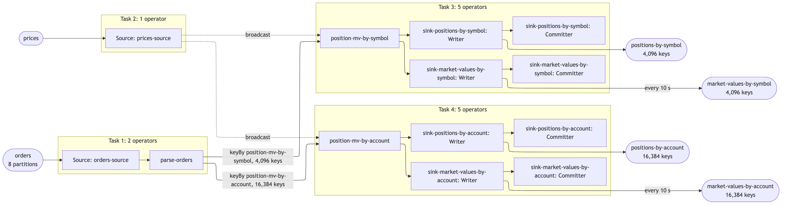

# st54 — positions and market values, proved to scale

A Flink DataStream pipeline that keeps trading positions by symbol and by
account / sub-account / symbol, values them against a price feed every 10
seconds, and a record of measuring how it scales across 1, 2 and 4 cores on one
laptop. Built in clean-room run 54 with the `scalable-flink-skill` and measured
only with its shipped harness, `harness/prove.py`.

What was agreed, assumed and planned before any number existed:
[`ANSWERS.md`](ANSWERS.md), [`ASSUMPTIONS.md`](ASSUMPTIONS.md), [`PLAN.md`](PLAN.md).
Changes made to chase a number: [`FIXES.md`](FIXES.md).

## What it does

In the interview's words (`ANSWERS.md`, question 1): *an order arrives with a
unique id and symbol, order quantity and a list of allocations; each allocation
is keyed by account / sub-account and carries a quantity. The pipeline maintains
positions by account+subaccount+symbol and by symbol. … A second input carries
prices, keyed by symbol and timestamp; the pipeline joins those to each of the
position outputs and emits a market value every 10 seconds for both.*

**Fan-out: 5 records per order** — one symbol position and one position for
each of the order's 4 allocations. Market values are not counted in that 5:
they are written per interval, not per order.

Keys: 4,096 symbols; 2 accounts × 2 sub-accounts × 4,096 symbols = 16,384
account keys.

## Topics

| topic | in or out | key | value | partitions | written by | `pipeline.json` list |
|---|---|---|---|---|---|---|
| `orders` | input, scaled | none (the generator picks the partition) | JSON order with 4 allocations | 8 | generator | `topics.in`, `design.inputs` |
| `prices` | input | symbol | JSON: symbol, timestamp, price in cents | 8 | generator, once | `design.inputs` |
| `positions-by-symbol` | output, one per order | symbol | JSON: symbol, position, n | 8 | job | `topics.out` |
| `positions-by-account` | output, four per order | `ACC/SUB/SYMBOL` | JSON: account, subAccount, symbol, position, n | 8 | job | `topics.out` |
| `market-values-by-symbol` | output, every 10 s per changed key | symbol | JSON: symbol, position, priceCents, priceTs, marketValueCents, n | 8 | job | `topicsAlsoWritten` |
| `market-values-by-account` | output, every 10 s per changed key | `ACC/SUB/SYMBOL` | JSON: account, subAccount, symbol, position, priceCents, priceTs, marketValueCents, n | 8 | job | `topicsAlsoWritten` |

`n` in every output is how many inputs have been applied to that key. It only
rises, so it is what the verifier judges order on. The harness also writes
copies of `orders` for the tiny proof and completeness (`orders-tiny`,
`orders-small`).

## Record formats

One real record off every topic, read after completeness:
[`results/records.md`](results/records.md).

## How the job is built

| operator (`design.operators`) | what it does |
|---|---|
| `orders-source` | reads `orders` at the case's parallelism; commits offsets on each checkpoint |
| `parse-orders` | parses each order once. The symbol leg goes out on the main output; one leg per allocation goes out on a side output |
| `prices-source` | reads `prices` from the start of the topic, and broadcasts every price to both aggregations |
| `position-mv-by-symbol` | keyed by symbol. Drops repeated orders (highest order id per input partition, per key), applies the signed quantity, publishes the absolute position. On 10-second boundaries publishes position × latest price for each key that changed |
| `position-mv-by-account` | the same, keyed by account / sub-account / symbol, one leg per allocation |
| `sink-positions-by-symbol` | Kafka sink, at-least-once, keyed by symbol, lz4 |
| `sink-positions-by-account` | Kafka sink, keyed by account key |
| `sink-market-values-by-symbol` | Kafka sink for the symbol market values |
| `sink-market-values-by-account` | Kafka sink for the account market values |

Guarantee: exactly-once checkpointing every 10 s; at-least-once sinks made
idempotent by publishing the absolute position per key.

The job graph, read off the running job by the harness:



[`results/graph.md`](results/graph.md) has the same drawing with its Mermaid source.

## Correctness

The verifier (`job/src/main/java/st54/Verify.java`) reads all four outputs and
the generator's manifest and exits non-zero on any miss, with no tolerances.

| assertion | clean run | killed run |
|---|---|---|
| each key's final position and input count equal the manifest | yes | yes |
| 4,096 symbol keys and 16,384 account keys on every output | yes | yes |
| sum of symbol positions = sum of account positions = manifest total | yes | yes |
| every market value = position × price; each key's last = final position × latest price | yes | yes |
| each key in exactly one partition | yes | yes |
| position rows = 1 × and 4 × unique orders | yes | not asserted: a restart replays |
| `n` per key never goes backwards (positions: exactly +1 each time) | yes | at most one backward step per key |

The input repeats 0.2% of its orders on purpose; every total counts each once.

## How to build and run it

```
export DOCKER_CONFIG=$HOME/.docker-nohelper
export PATH=/opt/homebrew/opt/openjdk@17/bin:$PATH
(cd job && mvn -q -B package)
python3 dashboard/make_dashboard.py
H=~/.claude/skills/scalable-flink-skill/harness/prove.py
nohup python3 $H all > results/all.log 2>&1 &     # up, preflight, completeness, tinyproof, fill, suite, report
```

Wait on `results/DONE`; `results/PROGRESS.txt` says where the chain is. The
steps one at a time: `prove.py up`, `preflight`, `completeness`, `tinyproof`,
`fill`, `suite`, `report`; `prove.py down` removes everything prefixed `st54`.

Dashboard: Grafana on <http://localhost:13000> (anonymous), dashboard
"st54 positions pipeline". Prometheus on port 19090.

## Results

- The headline, generated from the suite: [`results/headline.md`](results/headline.md)
- The full table: [`results/suite.md`](results/suite.md)
- The job graph: [`results/graph.md`](results/graph.md)
