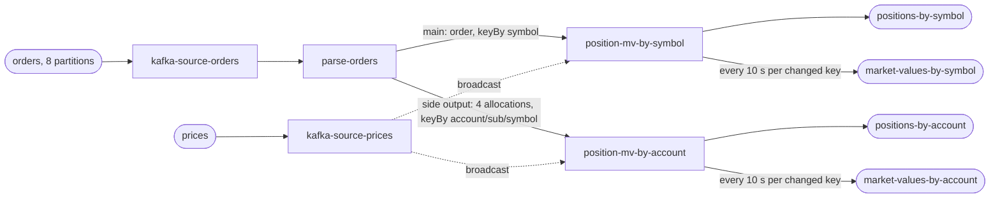

# Plan

**Nobody approved this plan.** It is clean-room run 55, with no human to ask.
SKILL.md §1a says to write the plan anyway and build against it, so a reader can
see what the run committed to before any number existed. Written 2026-10-14,
before any code.

## The test

| | |
|---|---|
| the objective | near-linear scaling across 1, 2 and 4 cores. Each step must return **1.80× or better** on a doubling. Two steps are reported, 1→2 and 2→4 |
| where it runs | this laptop (Apple Silicon, 8 cores, 16 GB; Docker VM 12,955 MiB), in Docker |
| the stack | `flink:1.20.1-scala_2.12-java17`, `apache/kafka:3.9.0` (question 6: Apache), plus Prometheus, Grafana and the skill's Docker CPU exporter for the dashboard |
| what is measured | the drain rate of a fixed backlog of orders at 1, 2 and 4 cores, read from committed broker offsets on `orders`, with the resource columns beside it. Second count: rows on the two position topics ÷ 5 |
| what is proved first | completeness with no tolerances on a small backlog, re-checked after killing the pipeline mid-run; no throughput table is published for a build that has not passed |
| what is built | the pipeline (one Flink DataStream job), a deterministic generator, a verifier, the dashboard, `README.md` and `pipeline.json` |
| the shape of the suite | 3 passes per case, ascending, descending, ascending, then the 1-core baseline once more as a drift check: **10 cases**, plus up to 6 more if a step's range reaches both sides of the target |
| the guarantee | exactly-once checkpointing every **5 s**; an at-least-once Kafka sink made idempotent by emitting the absolute position per key |
| how long it takes | estimate **2½ to 3½ hours** for the chain, plus the build before it |
| what it writes | three backlogs of orders: suite **300,000,000**, tiny proof **120,000,000**, completeness **10,000,000** records (guesses until the tiny proof measures the rate; they will be re-sized from it). Orders are lz4-compressed JSON; I expect tens of gigabytes of Kafka log in all, plus the outputs (5 position rows per order, recreated per case). Host free disk now: 114 GB |
| what it occupies | ports 19092 (Kafka), 18081 (Flink REST), 13000 (Grafana), 19090 (Prometheus); 8 partitions per topic; containers, volumes and network prefixed `st55` |
| where to watch it | `results/PROGRESS.txt` — one sentence, overwritten: which step of seven, which case of ten, roughly how long is left. I am a detached agent with no channel to the user while it runs, so **I promise no progress messages**: whoever started this run relays `results/PROGRESS.txt` |

## The six answers

Taken as the skill's defaults, verbatim in `ANSWERS.md`:

1. Orders (unique id, symbol, quantity, 4 allocations by account/sub-account) → positions by symbol and by account/sub-account/symbol, published per input; prices (by symbol and timestamp) joined to **both** and a market value emitted every 10 s for **both**.
2. Fan-out 5 per order (1 symbol position + 4 account positions). Market values are throttled and not counted.
3. 4,096 symbols; 2 accounts × 2 sub-accounts; so 16,384 account/sub-account/symbol keys.
4. Positions and market values in order per key; final positions match the input at both levels; market values at both levels = final position × latest price; duplicates counted once.
5. DataStream.
6. Apache Kafka.

Everything the answers did not settle is in `ASSUMPTIONS.md`, marked as mine.

## The design

- Read the input once, parse once, fan out through a side output (§6a row 1).
- Each keyed operator is a `KeyedBroadcastProcessFunction`: it keeps the running
  position, the count of inputs applied, and the highest order id applied per
  key (repeat dropping); it emits the position on every applied input and a
  market value on a processing-time timer at most once per interval per key.
- Four Kafka sinks: `sink-positions-by-symbol`, `sink-positions-by-account`,
  `sink-mv-by-symbol`, `sink-mv-by-account`.

## The order of work

1. Build the job, generator and verifier (one Maven module, one shaded jar).
2. Write `pipeline.json`, the dashboard and `README.md`.
3. Debug with single commands (`up`, `preflight`, `completeness`) until the
   build passes; take a rough rate from the completeness drain to size the backlogs.
4. Run `prove.py all` detached and wait on `results/DONE` with `watch.sh`.
5. If a step is not met: `probe --repeats 9` and `ceiling`, then §6's rule.
6. Commit the evidence at each step boundary.
