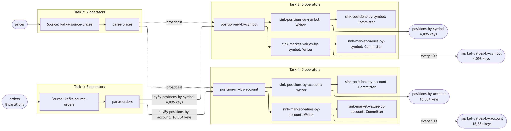

# st55 — positions and market values, proved to scale

A Flink DataStream pipeline built by clean-room run 55 of the
`scalable-flink-skill`, and measured with the skill's own harness
(`~/.claude/skills/scalable-flink-skill/harness/prove.py`) at 1, 2 and 4 cores.



## What it does

The interview's answers are the skill's defaults (`ANSWERS.md`), in the user's
words:

> An order arrives with a unique id and symbol, order quantity and a list of
> allocations; each allocation is keyed by account / sub-account and carries a
> quantity. The pipeline maintains positions by account+subaccount+symbol and by
> symbol. That input is the one scaled up to drive the pipeline to capacity. A
> second input carries prices, keyed by symbol and timestamp; the pipeline joins
> those to each of the position outputs and emits a market value every 10
> seconds for both. Positions themselves are published as they change, one per
> input — only the market value is throttled.

**Fan-out: 5 records per order** — every order carries exactly 4 allocations
(one to each of ACC1/SUB1, ACC1/SUB2, ACC2/SUB1, ACC2/SUB2), so it publishes 1
position by symbol and 4 positions by account/sub-account/symbol. Market values
are per interval, not per order, and are not counted in the fan-out.

Keys: 4,096 symbols; 4 account/sub-account pairs, so 16,384
account/sub-account/symbol keys. What I decided where the answers were silent
is in `ASSUMPTIONS.md`; what I committed to before building is in `PLAN.md`.

## Topics

| topic | role | key | value format | partitions | written by | `pipeline.json` list |
|---|---|---|---|---|---|---|
| `orders` | input, the one scaled | symbol | JSON order: id, sym, qty, ts, 4 allocations | 8 | generator (`st55.Gen`), via the harness's fill | `topics.in`, `design.inputs` |
| `prices` | second input, broadcast | symbol | JSON: sym, ts, cents | 8 | generator, once, when the topic is empty | `design.inputs` |
| `positions-by-symbol` | output, one per order | symbol | JSON: sym, pos, n | 8 | job (`sink-positions-by-symbol`) | `topics.out` |
| `positions-by-account` | output, four per order | ACCn/SUBn/Snnnn | JSON: acct, sub, sym, pos, n | 8 | job (`sink-positions-by-account`) | `topics.out` |
| `market-values-by-symbol` | output, every 10 s per changed key | symbol | JSON: sym, pos, price, priceTs, mv, n | 8 | job (`sink-market-values-by-symbol`) | `topicsAlsoWritten` |
| `market-values-by-account` | output, every 10 s per changed key | ACCn/SUBn/Snnnn | JSON: acct, sub, sym, pos, price, priceTs, mv, n | 8 | job (`sink-market-values-by-account`) | `topicsAlsoWritten` |

`n` in every output is the number of inputs applied to that key so far: it only
rises, which is what the ordering check is judged on. Prices and market values
are integer cents. The harness creates `orders` and recreates the four outputs
itself; the generator creates `prices`.

## Record formats

One real record off every topic, read by the harness after completeness:
[`results/records.md`](results/records.md).

## How the job is built

| operator (`design.operators`) | what it does |
|---|---|
| `kafka-source-orders` | reads `orders` with the harness's consumer group, committing offsets on each checkpoint |
| `parse-orders` | parses each order **once** (Jackson); the order goes on keyed by symbol, its 4 allocations leave through a side output keyed by account/sub-account/symbol |
| `kafka-source-prices` | reads `prices` from the earliest offset |
| `parse-prices` | parses a price record; the stream is then broadcast to both keyed operators |
| `position-mv-by-symbol` | keyed by symbol: running position, inputs applied, highest order id applied (drops repeats with one number per key); publishes the position on every applied order; keeps the latest price per symbol (by timestamp) in broadcast state; emits a market value on a processing-time timer at most every 10 s per changed key |
| `position-mv-by-account` | the same, keyed by account/sub-account/symbol, looking up the price by the key's symbol |
| `sink-positions-by-symbol`, `sink-positions-by-account` | at-least-once Kafka sinks, keyed by the aggregation key, lz4 |
| `sink-market-values-by-symbol`, `sink-market-values-by-account` | the same, for the two market values |

Guarantee: exactly-once checkpointing every 5 s; at-least-once sinks, made
idempotent by publishing the absolute position per key.

## Correctness

`st55.Verify` reads all four outputs end to end and compares them with the
generator's manifest — never with the pipeline. With no tolerances, on both
arms of the harness's completeness run:

- distinct keys: 4,096 on the symbol topics, 16,384 on the account topics;
- every key in exactly one partition;
- final position per key equals the manifest's total, at both levels, and the
  final count of orders applied equals the manifest's count;
- the two paths agree: the 4 account positions of a symbol add up to its symbol
  position;
- final market value per key = final position × latest price, at both levels;
- the input repeats 0.5% of its records on purpose; each is counted once.

Clean arm: no key's `n` ever goes backwards, every position is exactly one
input after the one before it, and the topics hold exactly 1 and 4 records per
unique order. Killed arm (the worker is killed mid-run and the job restarts
from its checkpoint): each key goes backwards at most once, and every final
value still matches.

## How to build and run it

```
export PATH=/opt/homebrew/opt/openjdk@17/bin:$PATH
export DOCKER_CONFIG=$HOME/.docker-nohelper
(cd job && mvn -q package)
H=~/.claude/skills/scalable-flink-skill/harness/prove.py
nohup python3 $H all > results/all.log 2>&1 &     # up, preflight, completeness, tinyproof, fill, suite, report
```

Wait on `results/DONE` (the harness's `watch.sh`); `results/PROGRESS.txt` says
where it is. The steps one by one: `python3 $H up`, `preflight`,
`completeness`, `tinyproof`, `fill`, `suite`, `report`; then `probe` and
`ceiling` when a step is not met; `down` removes everything prefixed `st55`.

The dashboard is Grafana on <http://localhost:13000> (Prometheus on 19090),
provisioned from `dashboard/`.

## Results

- Headline, generated from the suite: [`results/headline.md`](results/headline.md)
- The job graph: [`results/graph.md`](results/graph.md)
- The full table: [`results/suite.md`](results/suite.md)
- Changes made to chase a number, with predictions: [`FIXES.md`](FIXES.md)
