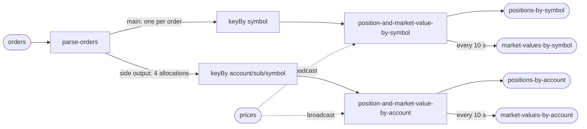

# Plan

**No one approved this plan.** This is clean-room run 56 with no human to ask
(SKILL.md §1a). It was written before any code or any number existed, and the
run builds against it. Answers: `ANSWERS.md` (the six defaults, verbatim).
Everything the answers did not settle: `ASSUMPTIONS.md`.

## The test

| | |
|---|---|
| the objective | near-linear scaling across 1, 2 and 4 cores. Each step must return **1.80× or better** on a doubling. Two steps are reported, 1→2 and 2→4 |
| where it runs | this laptop (Apple Silicon, 8 cores, 16 GB, Docker VM 12,955 MiB), in Docker |
| the stack | `flink:1.20.1-scala_2.12-java17` and `apache/kafka:3.9.0` (question 6: Apache), plus the harness's dashboard: Prometheus, Grafana, a container exporter, a Kafka metrics service |
| what is measured | the drain rate of a fixed backlog of orders at each core count, read from committed broker offsets, with the resource columns beside it. Second reading: output rows ÷ 5 |
| what is proved first | completeness with no tolerances, re-checked after killing the pipeline mid-run; no throughput table is published for a build that has not passed |
| what is built | the pipeline (one Flink DataStream job), a deterministic generator, a verifier, and the dashboard (the harness builds it) |
| the shape of the suite | 3 passes per case over 1, 2, 4 cores, ascending then descending then ascending, then the 1-core baseline once more as a drift check: **10 cases**, plus up to 6 more if a step's range straddles the target |
| the guarantee | exactly-once checkpointing every **10 s**; at-least-once Kafka sinks, made idempotent by publishing the absolute position per key |
| how long it takes | **about 3 hours** estimated (clean-room runs have taken two to three), plus the build before it |
| what it writes | three order backlogs: suite **150,000,000**, tiny proof **80,000,000**, completeness **10,000,000** records — guesses until the tiny proof measures the rate, then re-sized from it. At roughly 100 bytes stored per order that is tens of gigabytes of Kafka log, and the outputs are five records per order. Host free disk before starting: 105 GB |
| what it occupies | ports 19092 (Kafka), 18081 (Flink REST), 13000 (Grafana), 19090 (Prometheus); 8 partitions per topic; containers, volumes and network prefixed `st56` |
| where to watch it | `results/PROGRESS.txt` — one sentence, overwritten: which step of seven, which case of ten, roughly how long is left. I am a detached agent and cannot message anyone until I finish, so this file is the place to watch; whoever started the run relays it |

## The pipeline

- Input read **once**; the account path is a side output of the parse.
- Fan-out: 1 symbol position + 4 account positions = **5** per order. Market
  values are per interval and not counted.
- Keys: 4,096 symbols; 16,384 account / sub-account / symbol.
- `topics.in` = `orders`; `topics.out` = the two position topics;
  `topicsAlsoWritten` = the two market-value topics; `design.inputs` =
  `orders`, `prices`.

## Correctness (the verifier)

On both arms, with no tolerance: distinct keys (4,096 and 16,384) on all four
outputs; final position per key equals the manifest; final `n` per key equals
the manifest's distinct-order count; the account path sums to the symbol path
for every symbol; every market value's last record equals final position ×
latest price at both levels; each key appears in exactly one partition of each
output. Ordering: `n` never goes backwards for a key on the clean arm; at most
one backward step per key on the killed arm. The generator repeats 0.5% of
orders and every total still matches the manifest, which counts each order once.

## Order of work

1. Write the job, generator and verifier (one Maven module, one shaded jar
   with no Flink classes needed by the generator or verifier).
2. Unit-check the generator's determinism and the verifier locally on a tiny
   manifest before any stack.
3. Write `pipeline.json` from the harness README's field table, and `README.md`.
4. `prove.py all`, detached; wait on `results/DONE` with `watch.sh`.
5. If the tiny proof names a backlog size, re-size and run `all` again.
6. If a step falls short: `probe`, `ceiling`, then §6a, one change at a time,
   each predicted in `FIXES.md` before it is measured.

Commit at the end of each step with the build hash in the message.
