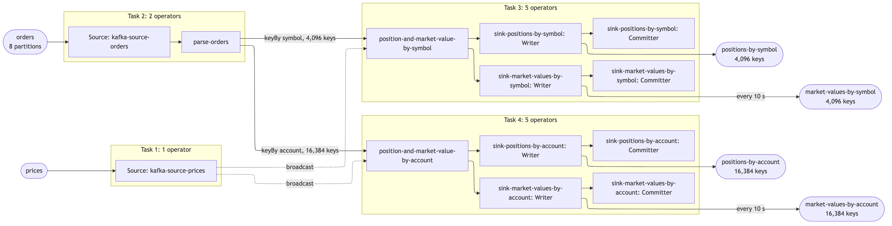

# Positions and market values — a Flink pipeline proved to scale

Clean-room run 56 of the `scalable-flink-skill`. One Flink DataStream job,
a deterministic generator and a verifier, measured at 1, 2 and 4 cores on one
laptop by the skill's own harness (`harness/prove.py`). The interview answers
are in [ANSWERS.md](ANSWERS.md) (the skill's defaults), what they left open is in
[ASSUMPTIONS.md](ASSUMPTIONS.md), and what was committed to before any number
existed is in [PLAN.md](PLAN.md).

## What it does

In the interview's words (question 1, the default): *an order arrives with a
unique id and symbol, order quantity and a list of allocations; each allocation
is keyed by account / sub-account and carries a quantity. The pipeline
maintains positions by account+subaccount+symbol and by symbol. … A second
input carries prices, keyed by symbol and timestamp; the pipeline joins those
to each of the position outputs and emits a market value every 10 seconds for
both … Positions themselves are published as they change, one per input — only
the market value is throttled.*

Fan-out: every order has exactly 4 allocations (one per account / sub-account
pair), so each order produces **5** position records: 1 by symbol and 4 by
account / sub-account / symbol. Market values are per interval (at most one per
key every 10 s) and are not part of the fan-out.

Keys: 4,096 symbols; 2 accounts × 2 sub-accounts × 4,096 symbols = 16,384
account keys.

## Topics

| topic | in / out | key | value | partitions | written by | `pipeline.json` list |
|---|---|---|---|---|---|---|
| `orders` | input, the one scaled to capacity | symbol | order JSON: id, symbol, qty, ts, 4 allocations (account, sub, qty) | 8 | generator (harness creates the topic per backlog) | `topics.in`, `design.inputs` |
| `prices` | input | symbol | price JSON: symbol, ts, priceCents | 8 | generator, once (16,384 prices, the same on every fill) | `design.inputs` |
| `positions-by-symbol` | output, one per order | symbol | symbol, position, n (orders applied), orderId | 8 | job | `topics.out` |
| `positions-by-account` | output, four per order | account/sub/symbol | account, sub, symbol, position, n, orderId | 8 | job | `topics.out` |
| `market-values-by-symbol` | output, every 10 s per changed key | symbol | symbol, position, priceCents, marketValueCents, priceTs, n | 8 | job | `topicsAlsoWritten` |
| `market-values-by-account` | output, every 10 s per changed key | account/sub/symbol | account, sub, symbol, position, priceCents, marketValueCents, priceTs, n | 8 | job | `topicsAlsoWritten` |

The orders backlogs the harness fills are `orders` (the suite), and its own
topics for the tiny proof and completeness.

## Record formats

One real record off every topic, read by the harness after completeness:
[results/records.md](results/records.md). Not typed here, so it cannot go stale.

## How the job is built



The drawing read off the running job is in [results/graph.md](results/graph.md).

| operator | what it does |
|---|---|
| `kafka-source-orders` | reads `orders` with the harness's consumer group; offsets committed on each checkpoint |
| `parse-orders` | parses each order once (Jackson streaming); the symbol change goes on the main output, the four allocations on a side output. The input is read once for both aggregations |
| `kafka-source-prices` | reads `prices` from the start, parallelism 1, broadcast to both aggregations |
| `position-and-market-value-by-symbol` | keyed by symbol. Drops a repeated order (id at or below the last applied to this key), adds the quantity, publishes the absolute position with `n`, and sets a timer at the next 10-second boundary; when it fires, publishes position × latest price |
| `position-and-market-value-by-account` | the same, keyed by account / sub-account / symbol, with the same broadcast prices |
| `sink-positions-by-symbol`, `sink-positions-by-account` | Kafka sinks, at-least-once, lz4, keyed by the aggregation key |
| `sink-market-values-by-symbol`, `sink-market-values-by-account` | Kafka sinks for the throttled market values |

Guarantee: exactly-once checkpointing every 10 s; at-least-once sinks made
idempotent by publishing the absolute value per key.

## Correctness

`st56.VerifyCompleteness` reads all four outputs to the end and compares them
with the generator's manifest, with no tolerance:

- distinct keys: 4,096 and 16,384, on positions and on market values;
- every key in exactly one partition of each output;
- every key's final position and final `n` equal the manifest;
- for every symbol, its four account positions sum to its symbol position;
- every key's last market value is its final position × the latest price
  (highest timestamp), at both levels;
- the input repeats about 0.5% of orders on purpose and every total still
  matches the manifest, which counts each order once.

On the **clean** arm no key's `n` ever goes backwards and it rises by exactly
one per record, so each order was published exactly once. On the **killed** arm
(the worker killed mid-run and restarted) a key may go backwards at most once,
and must still end on the manifest's values.

## How to build and run it

```
export JAVA_HOME=/opt/homebrew/opt/openjdk@17 PATH=/opt/homebrew/opt/openjdk@17/bin:$PATH
export DOCKER_CONFIG=$HOME/.docker-nohelper
(cd job && mvn -q package)
H=~/.claude/skills/scalable-flink-skill/harness/prove.py
nohup python3 $H all > results/all.log 2>&1 &      # up, preflight, completeness, tinyproof, fill, suite, report
```

Wait on `results/DONE`; `results/PROGRESS.txt` says where the chain is. Single
steps, when one needs re-running: `prove.py up`, `preflight`, `completeness`,
`tinyproof`, `fill`, `suite`, `report`, `probe`, `ceiling`, `down`.

## Results

- Headline: [results/headline.md](results/headline.md) (written by `prove.py report`)
- Job graph: [results/graph.md](results/graph.md)
- Full table: [results/suite.md](results/suite.md)
