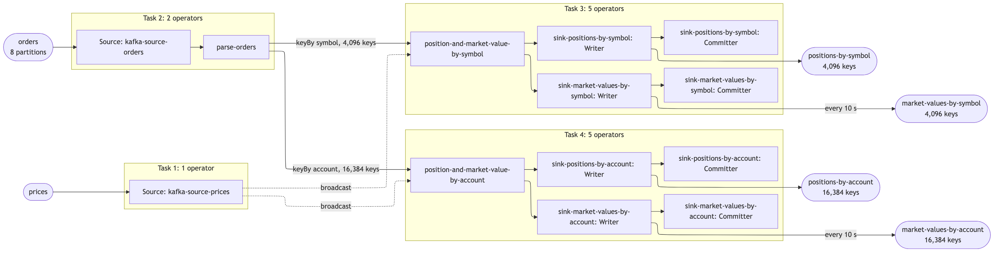
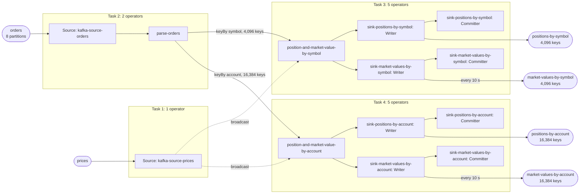

| field | value |
|---|---|
| axis | one machine, more cores: one task manager container capped at N cores, parallelism N, N slots |
| API level | Flink DataStream API, hand-written operators (no SQL, no Table API) |
| guarantee | state: exactly-once checkpointing; sink: at-least-once Kafka sinks, idempotent by publishing the absolute position per key |
| checkpoint interval | 10000 ms |
| build hash | `e35f29848e13cb4f` (completeness passed for `e35f29848e13cb4f`) |
| passes per case | 3 |
| study | scaling: every case configured identically |
| workload | 250,000,000 records, duplicateRecords 1,243,401, uniqueOrders 248,756,599, partitions 8, allocationsPerOrder 4, symbolKeyCount 4,096, accountKeyCount 16,384, priceRecords 16,384, 5 outputs per input |
| rate source | committed broker offsets on `orders` |
| CPU source | cgroup `cpu.stat usage_usec` |
| suite span | 2026-10-18 15:30:32 -> 2026-10-18 16:13:27 EDT (43m)  dashboard: from=1792351832451&to=1792354407742 |

**1→2 cores: not reported — the 1-core case does not count: its readings are 21.0% apart, over the 20% limit.**
**2→4 cores: not reported — the 4-core case does not count: its readings are 28.9% apart, over the 20% limit.**

| cores | speed | scaling | pipeline CPU | pipeline memory | Kafka CPU | Kafka memory | blocked by | what to do |
|---:|---:|---:|---|---|---|---|---|---|
| | | what the step into it gave | cores it could use / how much it used | memory it could use / share of the time spent tidying memory up | cores Kafka could use / how much it used | memory Kafka could use / how many times it filled up | | |
| 1 \* | 116,161/s | — | 1 / 100% | 1728m / 3.1% | 2.5 / 7% | 5g, full 934x | Pipeline CPU | check it matches |
| 2 | 200,254/s | — | 2 / 100% | 2368m / 1.3% | 2.5 / 14% | 5g, full 3,999x | Pipeline CPU | no usable step |
| 4 \* | 341,760/s | — | 4 / 100% | 3648m / 0.5% | 2.5 / 28% | 5g, full 12,139x | Pipeline CPU | no usable step |

| cores | pass | records/s | tm cores | % of cap | throttled | broker cores | src idle | src BP | headroom | vantage |
|---:|---|---:|---:|---:|---:|---:|---:|---:|---:|---:|
| 1 | p1-asc | 103,820 | 1.00 | 100.3% | 100% | 0.23 / 2.5 | 0.0% | 30.1% | 2267 s | 0.06% |
| 2 | p1-asc | 195,952 | 1.99 | 99.4% | 99% | 0.40 / 2.5 | 0.6% | 29.3% | 1066 s | 0.46% |
| 4 | p1-asc | 301,274 | 3.95 | 98.8% | 95% | 0.83 / 2.5 | 0.5% | 26.7% | 669 s | 1.06% |
| 4 | p2-desc | 323,899 | 3.96 | 98.9% | 95% | 0.81 / 2.5 | 0.7% | 24.8% | 610 s | 0.21% |
| 2 | p2-desc | 184,726 | 2.01 | 100.4% | 100% | 0.42 / 2.5 | 0.6% | 29.3% | 1214 s | 0.02% |
| 1 | p2-desc | 116,469 | 1.00 | 100.0% | 100% | 0.17 / 2.5 | 0.0% | 35.8% | 2006 s | 0.17% |
| 1 | p3-asc **(ceiling)** | 125,258 | 0.95 | 95.0% | 100% | 0.16 / 2.5 | 0.0% | 33.3% | 1864 s | 0.47% |
| 2 | p3-asc | 220,085 | 2.00 | 100.0% | 100% | 0.34 / 2.5 | 1.2% | 24.5% | 995 s | 0.26% |
| 4 | p3-asc | 400,108 | 3.99 | 99.7% | 98% | 0.70 / 2.5 | 0.7% | 24.7% | 480 s | 0.44% |
| 1 | sentinel | 128,193 | 1.00 | 100.3% | 100% | 0.17 / 2.5 | 0.0% | 34.2% | 1809 s | 0.97% |

| cores | passes | mean records/s | spread | reportable |
|---:|---:|---:|---:|---|
| 1 | 3 | 116,161 | 21.0% | no — its readings are 21.0% apart, over the 20% limit |
| 2 | 3 | 200,254 | 17.7% | yes |
| 4 | 3 | 341,760 | 28.9% | no — its readings are 28.9% apart, over the 20% limit |

Sentinel: the 1-core case first (103,820 rec/s) and last (128,193 rec/s), drift +21.0% across the suite; counted in that case's spread.

### The job graph that ran

Read off the running plan, not drawn. Every case ran this shape — a row whose shape differed would have been thrown out. 4 tasks, 13 operators. Each box is one Flink task. The operators inside a box are chained: they run in one thread, with no network hop between them. Arrows between boxes are how records cross from one task to another: keyBy is a hash shuffle that sends each key to one parallel instance, and broadcast sends every record to every instance. Rounded shapes are Kafka topics, outside Flink. Every task runs at the case's parallelism (1, 2 or 4). Partition and key counts come from the configuration and the run's own manifest; an interval on an output is what the build declared in design.every, not something the harness measured.

The same shape as the graph completeness drew (`graph.md`).
