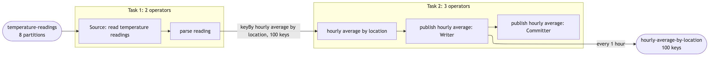
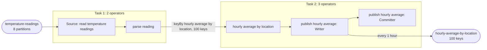

| field | value |
|---|---|
| axis | one machine, more cores |
| API level | DataStream |
| guarantee | state: exactly-once checkpointing; sink: at-least-once, idempotent (the absolute total and count per location and hour) |
| checkpoint interval | 10000 ms |
| build hash | `2fc501e9bece7d23` (completeness passed for `2fc501e9bece7d23`) |
| passes per case | 3 |
| study | scaling: every case configured identically |
| workload | 900,000,000 records, locationCount 100, sensorCount 1,000, sensorsPerLocation 10, recordBytes 103, hourMs 3,600,000, locationStaggerSeconds 36, partitions 8, closedWindowCount 24,999, readingsInClosedWindows 898,182,000 |
| rate source | committed broker offsets on `temperature-readings` |
| CPU source | cgroup `cpu.stat usage_usec` |
| suite span | 2026-10-12 18:25:48 -> 2026-10-12 19:24:56 EDT (59m)  dashboard: from=1791843948393&to=1791847496564 |

**1→2 cores: 1.98× (target 1.80×), range 1.82–2.12× across passes.**
**2→4 cores: 1.82× (target 1.80×), range 1.71–1.94× across passes.**

| cores | speed | scaling | pipeline CPU | pipeline memory | Kafka CPU | Kafka memory | blocked by | what to do |
|---:|---:|---:|---|---|---|---|---|---|
| | | what the step into it gave | cores it could use / how much it used | memory it could use / share of the time spent tidying memory up | cores Kafka could use / how much it used | memory Kafka could use / how many times it filled up | | |
| 1 | 788,097/s | — | 1 / 100% | 1536m / 1.5% | 2.5 / 1% | 5.5g, full 96x | Pipeline CPU | check it matches |
| 2 | 1,560,623/s | 1.98x | 2 / 100% | 2048m / 0.6% | 2.5 / 1% | 5.5g, full 970x | Pipeline CPU | add cores for more |
| 4 | 2,838,679/s | 1.82x | 4 / 99% | 3072m / 0.4% | 2.5 / 3% | 5.5g, full 2,313x | Pipeline CPU | add cores for more |

| cores | pass | records/s | tm cores | % of cap | throttled | broker cores | src idle | src BP | headroom | vantage |
|---:|---|---:|---:|---:|---:|---:|---:|---:|---:|---:|
| 1 | p1-asc | 792,700 | 1.00 | 99.6% | 100% | 0.02 / 2.5 | 10.5% | 0.0% | 990 s | 0.20% |
| 2 | p1-asc | 1,512,814 | 2.00 | 100.1% | 100% | 0.04 / 2.5 | 10.6% | 0.0% | 436 s | 0.05% |
| 4 | p1-asc | 2,824,024 | 3.98 | 99.4% | 98% | 0.09 / 2.5 | 15.1% | 0.0% | 161 s | 0.64% |
| 4 | p2-desc | 2,895,508 | 3.98 | 99.5% | 100% | 0.07 / 2.5 | 15.1% | 0.0% | 161 s | 0.25% |
| 2 | p2-desc | 1,553,498 | 2.00 | 100.2% | 100% | 0.03 / 2.5 | 8.4% | 0.0% | 426 s | 0.23% |
| 1 | p2-desc | 766,688 | 1.00 | 100.2% | 100% | 0.02 / 2.5 | 11.0% | 0.0% | 1026 s | 1.08% |
| 1 | p3-asc | 766,852 | 1.00 | 100.2% | 100% | 0.03 / 2.5 | 10.0% | 0.0% | 1020 s | 0.08% |
| 2 | p3-asc | 1,621,555 | 1.94 | 97.2% | 100% | 0.03 / 2.5 | 9.7% | 0.0% | 402 s | 3.13% |
| 4 | p3-asc | 2,783,913 | 3.96 | 98.9% | 100% | 0.07 / 2.5 | 14.9% | 0.0% | 174 s | 0.60% |
| 1 | sentinel | 826,150 | 1.00 | 99.9% | 100% | 0.02 / 2.5 | 12.1% | 0.0% | 940 s | 0.53% |
| 2 | settle-1 | 1,602,879 | 2.00 | 100.0% | 100% | 0.04 / 2.5 | 11.7% | 0.0% | 412 s | 0.42% |
| 4 | settle-2 | 2,773,701 | 3.98 | 99.6% | 100% | 0.07 / 2.5 | 16.4% | 0.0% | 167 s | 0.15% |
| 2 | settle-3 | 1,569,823 | 1.98 | 98.9% | 100% | 0.04 / 2.5 | 11.4% | 0.0% | 424 s | 0.96% |
| 4 | settle-4 | 2,916,250 | 3.98 | 99.4% | 100% | 0.07 / 2.5 | 16.0% | 0.0% | 146 s | 0.92% |
| 2 | settle-5 | 1,503,168 | 2.00 | 99.9% | 100% | 0.04 / 2.5 | 9.7% | 0.0% | 447 s | 0.36% |

| cores | passes | mean records/s | spread | reportable |
|---:|---:|---:|---:|---|
| 1 | 4 | 788,097 | 7.5% | yes |
| 2 | 6 | 1,560,623 | 7.6% | yes |
| 4 | 5 | 2,838,679 | 5.0% | yes |

Sentinel: the 1-core case first (792,700 rec/s) and last (826,150 rec/s), drift +4.1% across the suite; counted in that case's spread.

### The job graph that ran

Read off the running plan, not drawn. Every case ran this shape — a row whose shape differed would have been thrown out. 2 tasks, 5 operators. Each box is one Flink task. The operators inside a box are chained: they run in one thread, with no network hop between them. Arrows between boxes are how records cross from one task to another: keyBy is a hash shuffle that sends each key to one parallel instance, and broadcast sends every record to every instance. Rounded shapes are Kafka topics, outside Flink. Every task runs at the case's parallelism (1, 2 or 4). Partition and key counts come from the configuration and the run's own manifest; an interval on an output is what the build declared in design.every, not something the harness measured.

The same shape as the graph completeness drew (`graph.md`).
