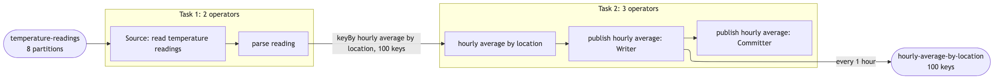
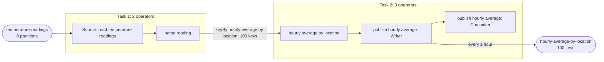

# The job graph

Build `a2d319dcf0390a80`, read off the running plan during completeness, not drawn by hand. 2 tasks, 5 operators. Each box is one Flink task. The operators inside a box are chained: they run in one thread, with no network hop between them. Arrows between boxes are how records cross from one task to another: keyBy is a hash shuffle that sends each key to one parallel instance, and broadcast sends every record to every instance. Rounded shapes are Kafka topics, outside Flink. Every task runs at the case's parallelism (1, 2 or 4). Partition and key counts come from the configuration and that run's manifest; an interval on an output is what the build declared in design.every, not something the harness measured.

Source: [`graph.mmd`](graph.mmd)

