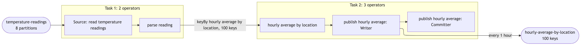
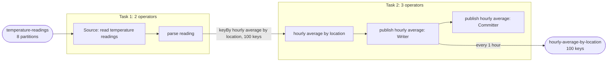

| field | value |
|---|---|
| axis | one machine, more cores |
| API level | DataStream |
| guarantee | state: exactly-once checkpointing; sink: at-least-once, idempotent (the absolute total and count per location and hour) |
| checkpoint interval | 10000 ms |
| build hash | `8ada16a74ff53772` (completeness passed for `8ada16a74ff53772`) |
| passes per case | 3 |
| study | scaling: every case configured identically |
| workload | 900,000,000 records, locationCount 100, sensorCount 1,000, sensorsPerLocation 10, recordBytes 103, hourMs 3,600,000, locationStaggerSeconds 36, partitions 8, closedWindowCount 24,999, readingsInClosedWindows 898,182,000 |
| rate source | committed broker offsets on `temperature-readings` |
| CPU source | cgroup `cpu.stat usage_usec` |
| suite span | 2026-10-17 19:39:20 -> 2026-10-17 20:21:13 EDT (42m)  dashboard: from=1792280360388&to=1792282873362 |

**1→2 cores: 1.84× (target 1.80×), range it is judged on 1.830x to 1.879x.**
**2→4 cores: 1.91× (target 1.80×), range it is judged on 1.807x to 1.941x.**

| cores | speed | scaling | pipeline CPU | pipeline memory | Kafka CPU | Kafka memory | blocked by | what to do |
|---:|---:|---:|---|---|---|---|---|---|
| | | what the step into it gave | cores it could use / how much it used | memory it could use / share of the time spent tidying memory up | cores Kafka could use / how much it used | memory Kafka could use / how many times it filled up | | |
| 1 | 822,298/s | — | 1 / 101% | 1536m / 1.6% | 2.5 / 1% | 5.5g, never full | Pipeline CPU | check it matches |
| 2 | 1,514,724/s | 1.84x | 2 / 98% | 2048m / 0.6% | 2.5 / 2% | 5.5g, never full | Pipeline CPU | add cores for more |
| 4 | 2,888,082/s | 1.91x | 4 / 100% | 3072m / 0.4% | 2.5 / 4% | 5.5g, never full | Pipeline CPU | add cores for more |

| cores | pass | records/s | tm cores | % of cap | throttled | broker cores | src idle | src BP | headroom | vantage |
|---:|---|---:|---:|---:|---:|---:|---:|---:|---:|---:|
| 1 | p1-asc | 840,616 | 1.00 | 100.2% | 100% | 0.03 / 2.5 | 11.6% | 0.0% | 921 s | 0.62% |
| 2 | p1-asc | 1,533,073 | 2.00 | 100.0% | 100% | 0.05 / 2.5 | 10.7% | 0.0% | 437 s | 0.17% |
| 4 | p1-asc | 2,871,696 | 3.98 | 99.5% | 100% | 0.10 / 2.5 | 15.5% | 0.0% | 163 s | 0.04% |
| 4 | p2-desc | 2,895,227 | 4.00 | 99.9% | 100% | 0.10 / 2.5 | 15.0% | 0.0% | 162 s | 0.24% |
| 2 | p2-desc | 1,544,940 | 1.92 | 95.7% | 100% | 0.05 / 2.5 | 11.2% | 0.0% | 430 s | 4.95% |
| 1 | p2-desc | 828,136 | 1.00 | 100.4% | 100% | 0.03 / 2.5 | 13.9% | 0.0% | 938 s | 1.04% |
| 1 | p3-asc | 790,736 | 0.97 | 96.9% | 100% | 0.03 / 2.5 | 10.5% | 0.0% | 995 s | 2.22% |
| 2 | p3-asc | 1,466,158 | 1.97 | 98.5% | 100% | 0.04 / 2.5 | 10.6% | 0.0% | 466 s | 1.22% |
| 4 | p3-asc | 2,897,324 | 3.98 | 99.6% | 100% | 0.10 / 2.5 | 15.7% | 0.0% | 164 s | 0.17% |
| 1 | sentinel | 829,706 | 1.00 | 100.5% | 100% | 0.03 / 2.5 | 13.9% | 0.0% | 938 s | 0.64% |

| cores | passes | mean records/s | spread | reportable |
|---:|---:|---:|---:|---|
| 1 | 4 | 822,298 | 6.1% | yes |
| 2 | 3 | 1,514,724 | 5.2% | yes |
| 4 | 3 | 2,888,082 | 0.9% | yes |

Sentinel: the 1-core case first (840,616 rec/s) and last (829,706 rec/s), drift -1.3% across the suite; counted in that case's spread.

### The job graph that ran

Read off the running plan, not drawn. Every case ran this shape — a row whose shape differed would have been thrown out. 2 tasks, 5 operators. Each box is one Flink task. The operators inside a box are chained: they run in one thread, with no network hop between them. Arrows between boxes are how records cross from one task to another: keyBy is a hash shuffle that sends each key to one parallel instance, and broadcast sends every record to every instance. Rounded shapes are Kafka topics, outside Flink. Every task runs at the case's parallelism (1, 2 or 4). Partition and key counts come from the configuration and the run's own manifest; an interval on an output is what the build declared in design.every, not something the harness measured.

The same shape as the graph completeness drew (`graph.md`).
