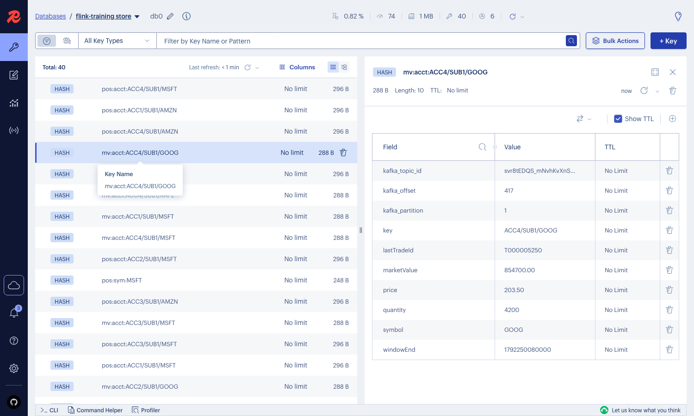

# The Redis store

The four outputs — `positions-by-symbol`, `positions-by-account`,
`mv-by-symbol`, `mv-by-account` — copied into Redis, the latest value per key,
updated in place. Optional: it runs only under the `store` compose profile, so
every scale script keeps measuring the stack it always has.

```bash
docker compose -f docker/compose.yml --profile store up -d
```

| | |
|---|---|
| Redis | `localhost:6379`, saved to disk every second, 256 MB cap, nothing evicted |
| Viewer | RedisInsight, <http://localhost:5540>. Accept its licence once on first open; the connection to this Redis is then already there |
| Dashboard | the last row, "Redis store — only with the store profile": the loader's lag, and records read against keys written |
| Proof | `scripts/verify-store.sh`, after stopping the generators |



## How it avoids back-pressure

The loader (`generators/.../store/StoreLoader.java`) is not part of the Flink
jobs. It reads the four topics the jobs already write, as one more consumer
group. The jobs never wait for it: if Redis is slow or stopped, the loader falls
behind and Kafka holds the difference until it catches up.

| | |
|---|---|
| What it reads | committed records only (`read_committed`); a record from a transaction the jobs aborted never reaches Redis |
| What it writes | one hash per key: the record's fields, plus the topic id, partition and offset it came from |
| Keys | `pos:sym:AAPL`, `pos:acct:ACC1/SUB1/AAPL`, `mv:sym:…`, `mv:acct:…` |
| Why it keeps up | each batch is cut to the last record per key before anything is written, so Redis sees about one write per key per batch — bounded by the 40 keys at demo rates, and by how many keys a batch touches at drain rates — not one per record |
| After a restart | it commits its Kafka position only after Redis accepts a batch, so it reads some records again; a write lands only if its offset is newer than what is stored, so a key never moves back |
| A recreated topic | the scale scripts delete and recreate the outputs between cases, and offsets start again at zero. The topic id tells the new topic from the old one: the loader reads the new one from the start and removes keys only the old one had |

## What was measured

### Redis stopped for a minute, at the assignment's 1,000 orders a second

| moment | Flink back-pressure | positions Flink wrote a second | records not yet in Redis |
|---|---|---|---|
| Redis stopped 20 s | 0 | 5,001 | 297,310 |
| Redis stopped 40 s | 0 | 5,000 | 397,545 |
| Redis stopped 60 s | 0 | 4,998 | 497,866 |
| Redis back 15 s | 0 | 5,002 | 5,010 — caught up |
| Redis back 30 s | 0 | 5,002 | 2,242 |

Flink wrote at the same rate the whole time, with no back-pressure. The loader
had also been killed outright and restarted earlier in the same run. Afterwards,
`verify-store.sh` read 1,905,465 committed records across the four topics and found every key
and every field in Redis matching the last one, and no other keys.

The check was tried against a store known to be wrong — one value changed and one
key added — and stopped, naming both.

### Throughput with and without the store

`scripts/scale-units.sh`, 2 and 4 units, 50 million orders drained, five passes
in a row on one laptop (8 cores, Docker on all 8), plugged in. The store arms ran
Redis and the loader beside the jobs; the others had both stopped.

| pass | store | 2 units, orders a second | 4 units, orders a second | step 2→4 |
|---|---|---|---|---|
| 1 | off | 78,601 | 151,042 | 1.92× |
| 2 | on, first version | 75,284 | 142,224 | 1.89× |
| 3 | on, tuned | 77,872 | 154,040 | 1.98× |
| 4 | off | 76,059 | 160,414 | 2.11× |
| 5 | on, tuned | 79,951 | 152,407 | 1.91× |

- **The two passes with the store off differ by 3.3% at 2 units and 6.2% at 4.**
  That is how far apart two runs of the same thing land on this laptop, and the
  yardstick for everything else in the table.
- **With the tuned loader there is no difference larger than that.** Averaged,
  the tuned passes are 2.0% faster at 2 units and 1.6% slower at 4 than the
  passes with no store. Both steps are above the 1.80× target.
- **The first version may have cost something at 4 units**: 142,224 is 5.8% and
  11.3% under the two passes with no store, outside their spread. One pass, so
  not proven.

The tuning was two changes made together, so which one mattered is not known:

| change | why |
|---|---|
| the loader capped at one core (`LOADER_CPUS`, default 1) | it averaged 0.45 of a core reading 666,000 records a second at 4 units, but in bursts of up to two cores each time a checkpoint made a batch readable — on the same machine as the jobs |
| record checksums not re-checked on read (`check.crcs=false`) | CPU spent on every record; the broker checked them on write |

With the cap the loader still keeps up. At 4 units it read 685,718 and 706,677
records a second in the two tuned passes, level with what the jobs wrote. Its lag
rises with each checkpoint and falls back to zero: read directly, it moved
between 0 and 2.4 million, about 3.5 seconds of output. Sampled through
Prometheus every 10 seconds, pass 3 peaked at 1.6 million and pass 5 read zero
every time. Why pass 5 only ever caught the troughs is not known; Prometheus
scrapes every 5 seconds, the same as the checkpoint interval, which would do it,
but that is not checked.

The raw output of each pass is in [`runs/`](runs/).
